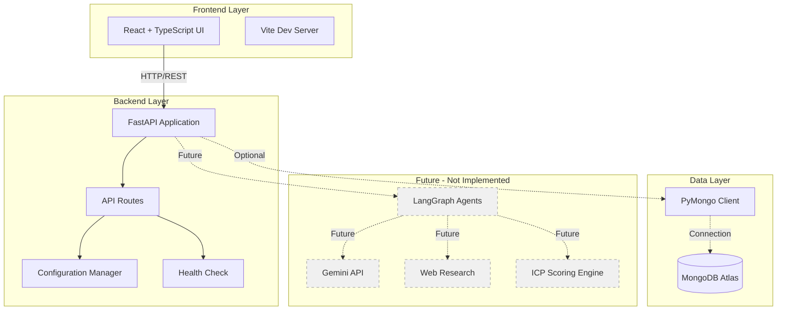
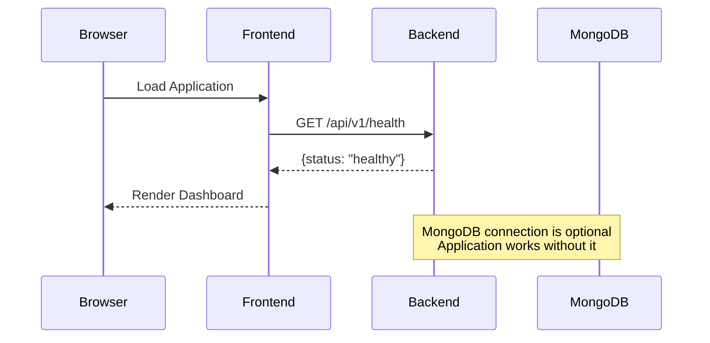

# Verityn Architecture - Phase 1

## Overview

This document describes the Phase 1 architecture of Verityn, the evidence-driven B2B lead intelligence platform. Phase 1 establishes the foundational infrastructure without implementing AI research or qualification features.

## System Architecture

## Component Details

### Frontend (React + TypeScript + Vite)

**Purpose:** User interface for lead research and qualification workflows

**Phase 1 Implementation:**
- Landing page with product overview
- Backend connection status indicator
- Empty-state placeholders for future features
- Responsive, accessible design
- Tailwind CSS styling with navy/neutral color scheme

**Technology Stack:**
- React 19.2.8
- TypeScript 6.0.2
- Vite 8.3.0
- Tailwind CSS 3.x

**Not Yet Implemented:**
- Lead management interface
- Research workflow
- Qualification dashboard
- Evidence review interface

### Backend (FastAPI)

**Purpose:** REST API server for business logic and data access

**Phase 1 Implementation:**
- FastAPI application with lifecycle management
- Health check endpoint (`GET /api/v1/health`)
- Environment-based configuration
- CORS middleware for frontend communication
- MongoDB client initialization (optional connection)

**Technology Stack:**
- Python 3.11+ (using 3.10.0)
- FastAPI 0.104.1
- Uvicorn 0.24.0
- Pydantic Settings 2.1.0

**Endpoints:**
- `GET /api/v1/health` - Application health status

**Not Yet Implemented:**
- Lead research endpoints
- ICP configuration endpoints
- Qualification scoring endpoints
- Evidence retrieval endpoints

### Database (MongoDB)

**Purpose:** Persistent storage for leads, research data, and evidence

**Phase 1 Implementation:**
- PyMongo client configuration
- Lazy connection initialization
- Graceful handling of connection failures
- Database ping utility for testing

**Technology Stack:**
- MongoDB Atlas compatible
- PyMongo 4.6.0

**Not Yet Implemented:**
- Database schemas and collections
- Data models
- Query patterns
- Indexing strategy

### Configuration Management

**Purpose:** Centralized application configuration

**Implementation:**
- Pydantic Settings for type-safe configuration
- Environment variable loading from `.env`
- Separated development and production settings
- No secrets in source code

**Configuration Sources:**
1. Environment variables
2. `.env` file (development)
3. Default values (fallback)

### Testing Strategy

**Backend Testing:**
- Pytest framework
- Unit tests for business logic
- API endpoint tests using TestClient
- Mocked external dependencies (MongoDB, future APIs)
- No internet or external service requirements

**Frontend Testing:**
- Build verification in Phase 1
- Future: Component tests, E2E tests

## Data Flow (Phase 1)

## Security Considerations

### Phase 1 Implementation

- Environment variables for configuration
- `.env` files excluded from version control
- No hardcoded secrets
- CORS configuration for frontend-backend communication
- Input validation using Pydantic models

### Future Phases

- API authentication and authorization
- Rate limiting
- API key management for external services
- Data encryption at rest and in transit
- Audit logging

## Deployment Architecture (Future)

Phase 1 runs locally only. Future deployment will include:

- **Frontend:** Static hosting (Vercel, Netlify, S3+CloudFront)
- **Backend:** Container deployment (Docker, Cloud Run, ECS)
- **Database:** MongoDB Atlas managed service
- **CI/CD:** GitHub Actions
- **Monitoring:** Application and infrastructure monitoring

## Technology Decisions

### Why FastAPI?
- High performance async framework
- Automatic OpenAPI documentation
- Built-in validation with Pydantic
- Type hints and modern Python features
- Easy testing with TestClient

### Why React + TypeScript?
- Type safety for large applications
- Strong ecosystem and tooling
- Component reusability
- Developer experience

### Why Vite?
- Fast development server
- Optimized production builds
- Native ESM support
- Simple configuration

### Why Tailwind CSS?
- Utility-first rapid development
- Consistent design system
- Small production bundle
- Excellent documentation

### Why MongoDB?
- Flexible schema for evolving data models
- Native JSON support
- Managed Atlas service
- Scalability for future growth

### Why PyMongo (not async)?
- Simpler synchronous code for Phase 1
- Easier testing and debugging
- Can migrate to Motor (async) if needed
- Sufficient performance for initial scale

## Future Architecture Components

The following components are planned but not yet implemented:

### LangGraph Agent Framework
- Multi-agent workflows for research
- State management for long-running tasks
- Error handling and retry logic
- Agent coordination

### Gemini API Integration
- LLM-powered analysis
- Evidence extraction
- Qualification reasoning
- Source verification

### Web Research Pipeline
- Public data source integration
- Rate limiting and retry logic
- Data validation and cleaning
- Source attribution tracking

### ICP Scoring Engine
- Configurable qualification criteria
- Weighted scoring algorithms
- Explainable decision logic
- Evidence-based justification

## Scalability Considerations

Phase 1 is designed to support future scaling:

- **Stateless Backend:** Easy horizontal scaling
- **Async Framework:** Ready for concurrent requests
- **MongoDB:** Horizontal scaling through sharding
- **Modular Architecture:** Independent component scaling

## Development Guidelines

### Backend
- Type hints for all functions
- Pydantic models for validation
- Separate business logic from routes
- Comprehensive error handling
- No silent exception swallowing

### Frontend
- TypeScript strict mode
- Functional components with hooks
- Semantic HTML for accessibility
- Responsive design patterns
- Loading and error states

### Testing
- Tests must not require external services
- Mock external dependencies
- Test edge cases and error paths
- Maintain high code coverage

## Phase Roadmap

- ✅ **Phase 1:** Foundation infrastructure (current)
- 🔲 **Phase 2:** LangGraph and Gemini integration
- 🔲 **Phase 3:** Web research pipeline
- 🔲 **Phase 4:** ICP configuration and scoring
- 🔲 **Phase 5:** Evidence tracking and review
- 🔲 **Phase 6:** Production deployment

## References

- [FastAPI Documentation](https://fastapi.tiangolo.com/)
- [React Documentation](https://react.dev/)
- [MongoDB Documentation](https://docs.mongodb.com/)
- [LangGraph Documentation](https://langchain-ai.github.io/langgraph/)
- [Gemini API Documentation](https://ai.google.dev/docs)
